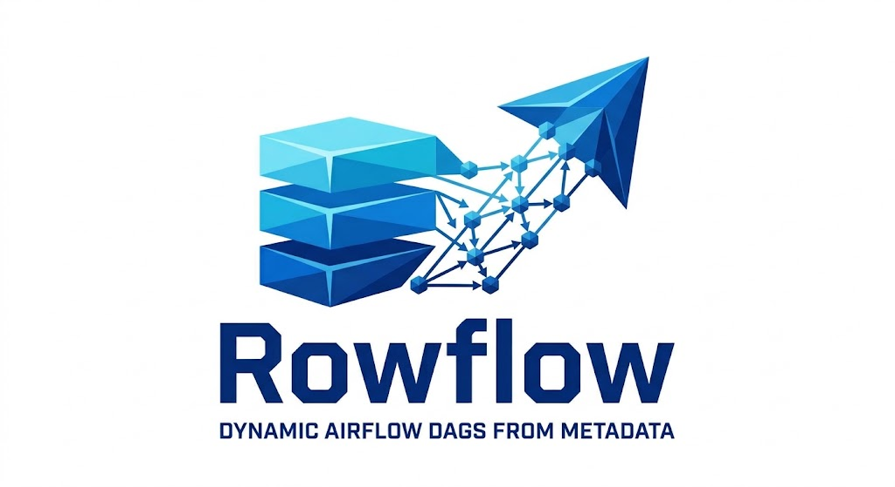
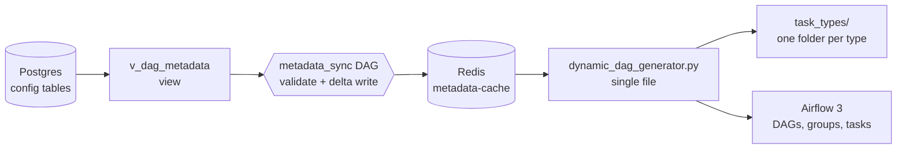
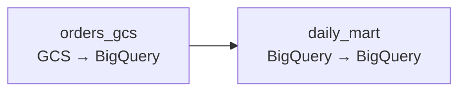
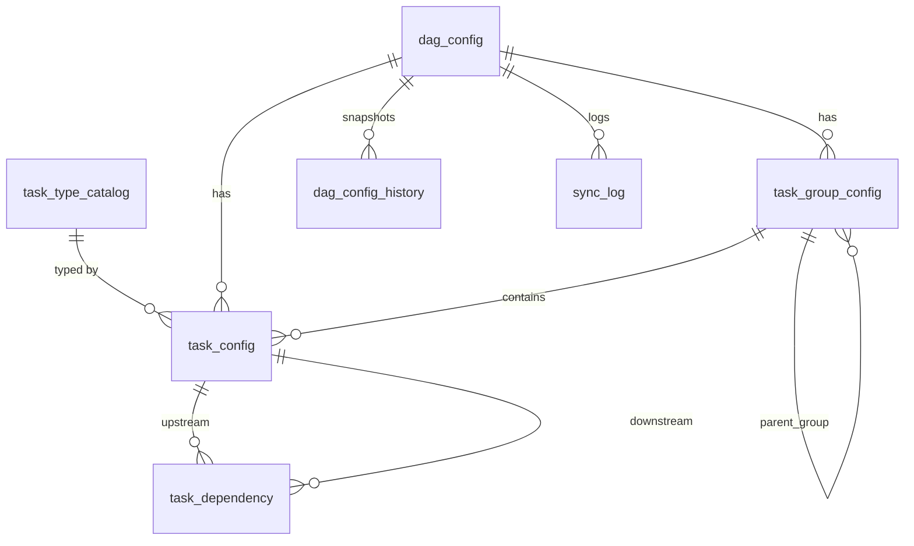

<div align="center">

# Rowflow 🚀

**Define it in Postgres. Airflow builds the DAGs. You never touch a file.**



[](LICENSE)
[](https://airflow.apache.org/)
[](https://www.postgresql.org/)
[](https://redis.io/)

[](https://github.com/rejanuis/rowflow)

[Quick start](#-quick-start) · [Interactive ERD](docs/erd.html) · [Task types](dags/dag_factory/task_types/README.md) · [Architecture](docs/ARCHITECTURE.md) · [Docs](#-documentation-guides)

</div>

---

Rowflow is a metadata-driven orchestration framework that stores your entire ETL topology (DAGs, task groups, tasks, and upstream/downstream dependencies) as **rows in PostgreSQL**. Apache Airflow renders and runs them dynamically. Say goodbye to managing thousands of static Python DAG files.

## 🤔 Why Rowflow?

Once you have hundreds of similar pipelines, hand-written DAG files become copy-paste, slow reviews and risky deploys.

<table>
<tr><th>Before: one Python file per pipeline</th><th>After: a few rows</th></tr>
<tr><td>

```python
with DAG("sales_daily", schedule="0 2 * * *",
         start_date=datetime(2026, 1, 1)) as dag:
    orders = GCSToBigQueryOperator(
        task_id="orders_gcs", bucket="raw",
        source_objects=["orders/*.csv"], ...)
    mart = BigQueryInsertJobOperator(
        task_id="daily_mart", configuration={...})
    orders >> mart
# ...then 999 more files
```

</td><td>

```sql
INSERT INTO task_config(...) VALUES
 ('sales_daily','orders_gcs','gcs_to_bq',
  '{"bucket":"raw","objects":["orders/*.csv"]}',
  '{"table":"proj.raw.orders"}'),
 ('sales_daily','daily_mart','bq_to_bq',
  '{"sql":"select ..."}',
  '{"table":"proj.mart.daily"}');
INSERT INTO task_dependency VALUES
 ('sales_daily','orders_gcs','daily_mart');
```

</td></tr>
</table>

Change a schedule, add a task or rewire a dependency with an `UPDATE`, not a code release. Because pipelines are data, a UI or API can create them too (planned, see the roadmap).

## ✨ Highlights

| | |
|---|---|
| 🗄️ **Config as data** | DAGs, nested task groups, tasks and dependencies in Postgres, with an [interactive ERD](docs/erd.html) |
| 🧩 **One folder per task type** | GCS → BigQuery, BigQuery → BigQuery, Postgres → BigQuery, BigQuery → files. [Add your own](#-add-your-own-task-type-in-one-folder) in minutes |
| 🔁 **Dynamic task mapping** | A JSON list in the config becomes one task instance per entry |
| ✅ **Validated before it goes live** | Cycles, unknown tasks, missing or malformed settings are caught at sync time; a bad DAG keeps its last good version |
| ⚡ **A cache between DB and Airflow** | The generator reads Redis only and never touches your config database, so a DB hiccup can’t break DAG parsing |
| 🔄 **A sync you control** | An Airflow DAG: every 3 hours, or one click in the UI, with dry-run and single-DAG options |
| 🔒 **Secure by default** | TLS reverse proxy, real user login, random secrets, no port 8080 |

## 🏗️ Architecture & How It Works



- The **config DB** holds your pipeline definitions. The view `v_dag_metadata` returns one ready-to-use row per DAG.
- The **`metadata_sync` DAG** validates every DAG (cycles, unknown tasks, missing settings), then writes only the changed ones to the **metadata-cache** (Redis). A bad config keeps its last good version.
- The **single generator file** reads only the cache, never the database, and builds all DAGs, task groups and tasks. Operators come from the task type folders.
- Airflow’s own metastore is filled by Airflow itself when it parses the generator. Never write to it directly.
- Access is through an **nginx TLS proxy on port 8443**; Airflow no longer uses port 8080.

Design decisions and failure modes: [docs/ARCHITECTURE.md](docs/ARCHITECTURE.md).

## 👀 See it in action

The two tasks and one dependency above become this DAG after the next sync:



The bundled sample (`sql/002_sample_data.sql`) also shows nested task groups, a Postgres extract-and-load pair, and dynamic task mapping.

## ⚡ Quick start

You need Docker Compose 2.24.4 or newer, `bash` and `openssl`.

```bash
git clone https://github.com/rejanuis/rowflow.git && cd rowflow
curl -LfO 'https://airflow.apache.org/docs/apache-airflow/stable/docker-compose.yaml'
bash scripts/setup_security.sh                       # random secrets + dev TLS certificate

docker compose up -d configdb
for f in 001_schema 002_sample_data 003_views; do
  docker compose exec -T configdb psql -U postgres -d config < sql/$f.sql
done

docker compose up airflow-init
docker compose run --rm airflow-scheduler airflow fab-db migrate
docker compose up -d
docker compose exec airflow-apiserver airflow users create \
  --username admin --firstname Admin --lastname User --role Admin --email you@example.com
```

Open **https://localhost:8443**, log in, unpause and trigger **`metadata_sync`**, and the `sales_daily` DAG appears about a minute later. Every step, with troubleshooting, is in [docs/GETTING_STARTED.md](docs/GETTING_STARTED.md).

## 🧰 Supported task types

| task_type | Flow | Operators used |
|---|---|---|
| [`gcs_to_bq`](dags/dag_factory/task_types/gcs_to_bq/README.md) | GCS → BigQuery | GCSToBigQueryOperator |
| [`bq_to_bq`](dags/dag_factory/task_types/bq_to_bq/README.md) | BigQuery → BigQuery | BigQueryInsertJobOperator |
| [`pg_to_bq`](dags/dag_factory/task_types/pg_to_bq/README.md) | Postgres → BigQuery | PostgresToGCS + GCSToBigQuery (built as a small task group) |
| [`bq_to_files`](dags/dag_factory/task_types/bq_to_files/README.md) | BigQuery → files in GCS | BigQueryToGCSOperator |

Dynamic task mapping: set `task_config.mapping` to a list of overrides and you get one task instance per entry. Settings for each type are in its folder README and in [docs/OPERATIONS.md](docs/OPERATIONS.md).

## 🧩 Add your own task type in one folder

```
dags/dag_factory/task_types/
└── my_new_type/
    ├── spec.py      # required settings + validation rules (pure Python)
    ├── build.py     # build(task_id, source, sink) -> operator(s)
    └── README.md
```

Folders are discovered automatically, so there is no central list to edit. A `spec.py` defines what the type needs, `build.py` creates the operator, and validation runs at sync time. Step by step: [task_types/README.md](dags/dag_factory/task_types/README.md).

## 🗺️ Data model

Seven tables and one read-model view. **[Explore the interactive ERD](docs/erd.html)**: click a table to see how it connects. (To host it, enable GitHub Pages for the `/docs` folder.)



UI mapping planned for Phase 2: `project_name / team_name` → `dag_config`, `etl_name` → `task_config.task_id`, upstream/downstream → `task_dependency`.

## 🔒 Secure by default

Airflow listens on an internal port only. nginx terminates TLS on 8443 and is the only published port. Login uses Airflow’s FAB auth manager with roles; secrets are random per install; the worker-only Execution API is blocked from outside; login endpoints are rate limited. Details and a checklist: [docs/SECURITY.md](docs/SECURITY.md).

## 🆚 How it compares

| | Hand-written DAG files | File-based generators (YAML/JSON, e.g. dag-factory) | **Rowflow** |
|---|---|---|---|
| Where pipelines are defined | Python in Git | YAML/JSON in Git | **Rows in Postgres** |
| Change without a code deploy | No | No (still a file deploy) | **Yes** |
| Ready for a UI or API to edit | No | Awkward | **Yes (tables + view)** |
| Validation before publishing | Your tests | Varies | **Built in; keeps last good version** |
| DB access during DAG parsing | n/a | n/a | **None (reads the cache)** |
| Moving parts | Fewest | Few | **More: Postgres + Redis + sync DAG** |

## 🤷 When not to use it

- You have a handful of DAGs: plain Python is simpler.
- Every pipeline change must go through Git pull request review: config in a database has a weaker review trail (a history table is kept, but it is not a code review).
- You can’t run Redis reliably: the generator depends on the cache.

## 🗂️ Project layout

```
docker-compose.security.yaml      override for the official Airflow compose (port, TLS proxy, auth, secrets)
.env.example                      template; scripts/setup_security.sh creates the real .env
config/webserver_config.py        login settings (FAB auth manager)
security/nginx/airflow.conf       TLS reverse proxy config
scripts/setup_security.sh         generates secrets + dev TLS certificate
sql/001_schema.sql                tables
sql/002_sample_data.sql           sample pipeline (sales_daily)
sql/003_views.sql                 v_dag_metadata (read model for the sync)
dags/metadata_sync_dag.py         the sync DAG (every 3h + manual trigger)
dags/dynamic_dag_generator.py     single file: builds DAGs/groups/tasks from the cache
dags/dag_factory/task_types/      one folder per task type (spec.py + build.py)
dags/dag_factory/validation.py    shared validation (pure Python)
dags/dag_factory/metadata_sync.py sync logic
dags/.airflowignore               tells Airflow not to scan dag_factory/ as DAG files
tests/                            pytest tests (validation; generator with real Airflow)
sync/sync_metadata_cache.py       command-line version of the sync (fallback)
docs/                             guides, architecture notes and the interactive ERD
```

## 📚 Documentation Guides

| Read this | When |
|---|---|
| [docs/GETTING_STARTED.md](docs/GETTING_STARTED.md) | First install: step by step, from zero to a running, secured Airflow |
| [docs/OPERATIONS.md](docs/OPERATIONS.md) | Daily use: start/stop, add or change pipelines, manual sync, troubleshooting, scaling |
| [docs/SECURITY.md](docs/SECURITY.md) | Login, TLS, ports, secrets, users, what is not covered |
| [docs/ARCHITECTURE.md](docs/ARCHITECTURE.md) | Design decisions, failure modes, how to extend |
| [docs/erd.html](docs/erd.html) | Interactive data model |

## 🔍 Status and known limits

**Alpha.** Tested: SQL schema and views on a real Postgres, validation rules, cache write logic, and secret and TLS generation. The generator is covered by `pytest` tests that build the sample DAG (nested groups, task mapping, dependencies) with real Airflow 3.4 and the Google provider. It has not run in production yet, so please report what you find.

- No Postgres → BigQuery type mapping yet: `pg_to_bq` relies on BigQuery autodetect.
- No data quality checks in the task types yet.
- Hive: no direct operator. Use `bq_to_files`, then a Hive external table.
- Dynamic task mapping is not supported for the multi-step `pg_to_bq` type.
- A single generator file builds every DAG in a shard, so load-test before going to thousands of DAGs (see OPERATIONS, “Scaling”).
- Phase 2 (UI, CRUD API, monitoring agent) is not built yet.

## 🛣️ Roadmap

- [x] Config schema, view, validation, cache, sync DAG, secure compose setup, one-folder task types
- [x] Unit tests for validation and the generator (`pytest`)
- [ ] CI (GitHub Actions) running the tests
- [ ] Postgres → BigQuery type mapping and data quality checks per task type
- [ ] Phase 2: web UI to build pipelines (pick source and sink)
- [ ] Phase 2: CRUD API over the config tables
- [ ] Phase 2: AI monitoring agent for failed or unfinished DAGs
- [ ] More task types, per-team permissions, SSO example

## 🤝 Contributing

Issues and pull requests are welcome: see [CONTRIBUTING.md](CONTRIBUTING.md). New task types are the easiest first contribution. If Rowflow saves you time, a ⭐ helps others find it. Please report vulnerabilities privately: [.github/SECURITY.md](.github/SECURITY.md).

## 📄 License

MIT, see [LICENSE](LICENSE). Apache Airflow, its providers, Redis, Postgres and nginx are separate projects under their own licenses; this repository only configures and uses them. Rowflow is not affiliated with or endorsed by the Apache Software Foundation.
