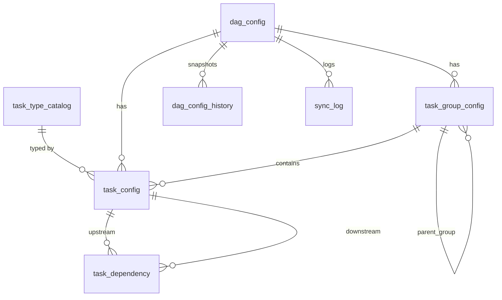

# Rowflow

> Define it in Postgres. Airflow builds the DAGs. You never touch a file.

Define ETL pipelines (DAGs, task groups, tasks, upstream/downstream) as rows in Postgres. Airflow builds them dynamically, so you never hand-maintain thousands of DAG files.

| Read this | When |
|---|---|
| [docs/GETTING_STARTED.md](docs/GETTING_STARTED.md) | First install: step by step, from zero to a running, secured Airflow |
| [docs/OPERATIONS.md](docs/OPERATIONS.md) | Daily use: start/stop, add or change pipelines, manual sync, troubleshooting, scaling |
| [docs/SECURITY.md](docs/SECURITY.md) | Login, TLS, ports, secrets, users, what is not covered |

## How it works

```
Postgres config DB            Redis                      Airflow 3
 (tables + v_dag_metadata) -> metadata-cache  ->  dynamic_dag_generator.py  -> DAGs / groups / tasks in the UI
        ^                          ^
        |                          |
        +---- metadata_sync DAG ---+   every 3 hours, or click "Trigger" in the Airflow UI
              (validates first; a bad config keeps its last good version)
```

- The **config DB** holds your pipeline definitions. The view `v_dag_metadata` returns one ready-to-use row per DAG.
- The **`metadata_sync` DAG** validates every DAG (cycles, unknown tasks, missing settings), then writes only the changed ones to the **metadata-cache** (Redis).
- The **single generator file** reads only the cache, never the database, and builds all DAGs, task groups and tasks.
- Airflow's own metastore is filled by Airflow itself when it parses the generator. Never write to it directly.
- Access is through an **nginx TLS proxy on port 8443**; Airflow no longer uses port 8080.

## Project layout

```
docker-compose.security.yaml      override for the official Airflow compose (port, TLS proxy, auth, secrets)
.env.example                      template; scripts/setup_security.sh creates the real .env
config/webserver_config.py        login settings (FAB auth manager)
security/nginx/airflow.conf       TLS reverse proxy config
scripts/setup_security.sh         generates secrets + dev TLS certificate
sql/001_schema.sql                tables
sql/002_sample_data.sql           sample pipeline (sales_daily)
sql/003_views.sql                 v_dag_metadata (read model for the sync)
dags/metadata_sync_dag.py         the sync DAG (every 3h + manual trigger)
dags/dynamic_dag_generator.py     single file: builds DAGs/groups/tasks from the cache
dags/dag_factory/                 validation.py (shared), metadata_sync.py (sync logic)
dags/.airflowignore               tells Airflow not to scan dag_factory/ as DAG files
sync/sync_metadata_cache.py       command-line version of the sync (fallback)
docs/                             the guides above
```

## ERD



UI mapping planned for Phase 2: `project_name / team_name` -> `dag_config`, `etl_name` -> `task_config.task_id`, upstream/downstream -> `task_dependency`.

## Supported task types

| task_type | Flow | Operators used |
|---|---|---|
| `gcs_to_bq` | GCS -> BigQuery | GCSToBigQueryOperator |
| `bq_to_bq` | BigQuery -> BigQuery | BigQueryInsertJobOperator |
| `pg_to_bq` | Postgres -> BigQuery | PostgresToGCS + GCSToBigQuery (built as a small task group) |
| `bq_to_files` | BigQuery -> files in GCS | BigQueryToGCSOperator |

Dynamic task mapping: set `task_config.mapping` to a list of overrides and you get one task instance per entry.
Config keys for each type are in [docs/OPERATIONS.md](docs/OPERATIONS.md).

## Status and known limits

- Tested: SQL schema and views on a real Postgres, validation rules, cache write logic, secret and TLS generation.
- There are no Mapping Postgres Type to BigQuery Type.
- There are no data quality checks in each task_config type. 
- Hive: no direct operator. Use `bq_to_files`, then a Hive external table.
- Mapping is not supported for the composite `pg_to_bq` type.
- A single generator file builds every DAG in a shard, so load-test before going to thousands of DAGs (see OPERATIONS, "Scaling").
- Phase 2 (UI, CRUD API, monitoring agent) is not built yet.
