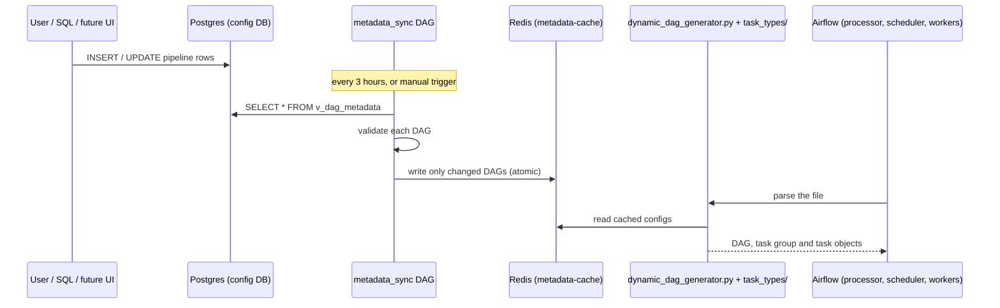

# Rowflow: architecture and design decisions

## Data flow

## Decisions

| Decision | Why | Trade-off |
|---|---|---|
| **Separate config DB**, never the Airflow metastore | The metastore schema is internal and changes between versions | One more database to run and back up |
| **A cache between the DB and Airflow** | DAG files are parsed constantly, and Airflow 3 workers parse them again at every task start. Querying Postgres from DAG code would add load and make an outage break parsing | Redis becomes a dependency; changes appear after the next sync plus one parse |
| **A read-model view** (`v_dag_metadata`) | The sync runs one plain `SELECT`. The joins and JSON nesting live in SQL, where they can be tested and reused by a future API/UI | View changes need a migration |
| **One generator file, one folder per task type** | The generator only orchestrates (groups, dependencies, mapping); what each type needs and how it builds lives in its own folder | One file parses every DAG in its shard. Large installs should shard (see below) |
| **Validate in the sync, again in the generator** | Bad configs never reach Airflow, and the generator is still defended if the cache is edited by hand | Validation code is shared by both, so it must stay free of Airflow imports |
| **Last good version wins** | One broken config must not remove a working DAG | A bad edit can go unnoticed unless you watch the `report` task |
| **Delta writes with content hashes** | Unchanged DAGs are untouched, so Airflow 3 does not create new DAG versions every sync | Requires deterministic output (sorted keys and lists) |
| **Sync as an Airflow DAG**, with a CLI fallback | Visible in the UI, schedulable, triggerable by clicking | If Airflow is down nothing syncs; the CLI covers that |
| **No secrets in config tables** | Rows store Airflow connection IDs only | Connections must exist in Airflow |

## Scaling note

Airflow parses a file in one process, and workers re-parse it per task. A single generator file is fine for hundreds of DAGs. For thousands, set `DAG_SHARDS=N` and copy the file as `dynamic_dag_generator_00..NN.py`; each copy builds only its shard. Measure before relying on it: [docs/OPERATIONS.md](OPERATIONS.md#8-scaling-to-thousands-of-dags).

## Failure modes

| What fails | Result | Recovery |
|---|---|---|
| Config DB down | Sync fails and retries; Airflow keeps running from the cache | Fix the DB; sync again |
| Redis down or empty | Generator raises an import error; existing DAG definitions are not refreshed | Restore Redis (enable persistence), then run `metadata_sync` |
| Invalid DAG config | `report` task fails; that DAG keeps its last good version | Fix the rows; sync again |
| Airflow down | Pipelines do not run; config still editable | Use the CLI sync fallback if needed |
| Two syncs at once | The second skips (Postgres advisory lock) | None needed |

## Adding a task type

Each type is one folder under `dags/dag_factory/task_types/`, discovered automatically:

1. `spec.py` exports `SPEC = TaskTypeSpec(...)` with the required keys (such as `"source.bucket"`) and an optional `check(source, sink)` for format rules. It is pure Python, so the sync job can validate without Airflow installed.
2. `build.py` defines `build(task_id, source, sink)` returning a list of `Step(name, OperatorClass, kwargs)`. One step is a plain task; several steps are wrapped in a task group and chained in order. Provider classes are imported inside `build()` to keep DAG parsing cheap.
3. Add a row to `task_type_catalog` and a `README.md` in the folder.

The `task_type` value from the database can only select an existing folder, so config data can never import arbitrary code. Full guide: [task_types/README.md](../dags/dag_factory/task_types/README.md).

## Security design

Airflow listens on an internal port only. nginx terminates TLS and is the only published port. See [SECURITY.md](SECURITY.md).
